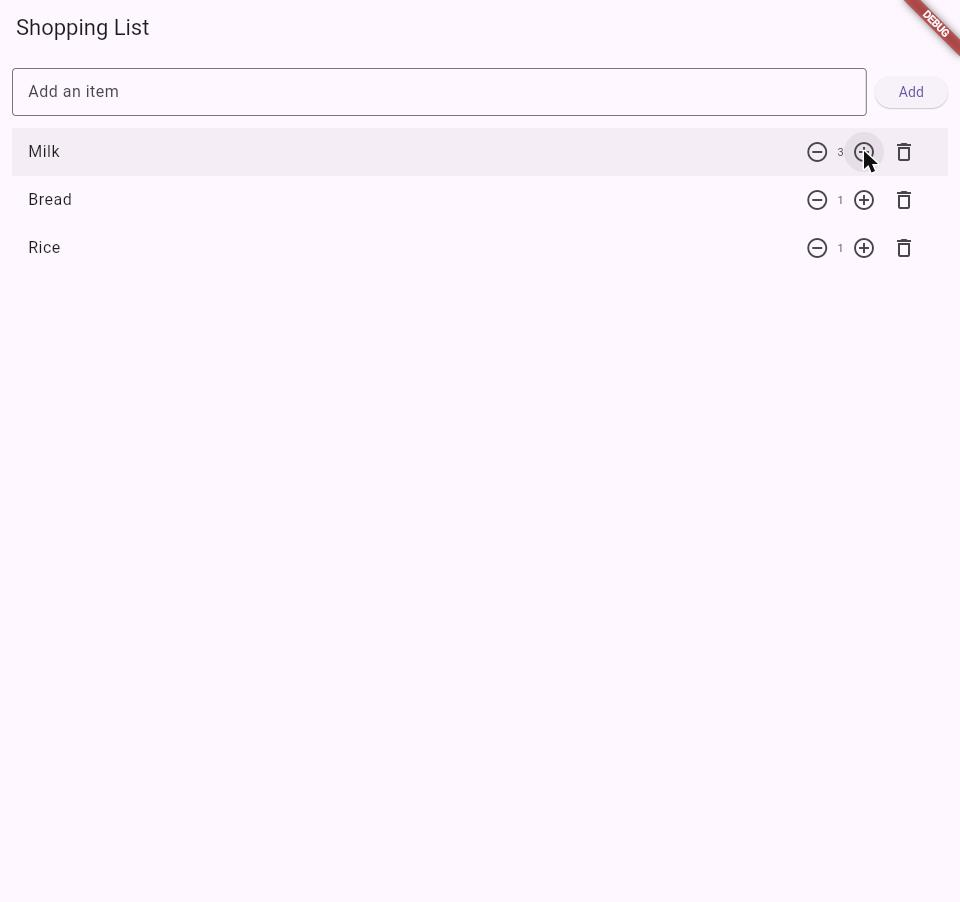
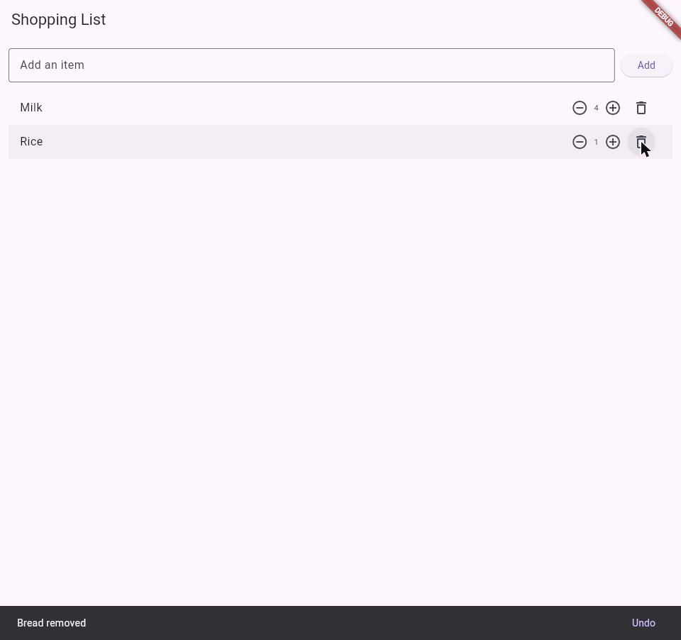
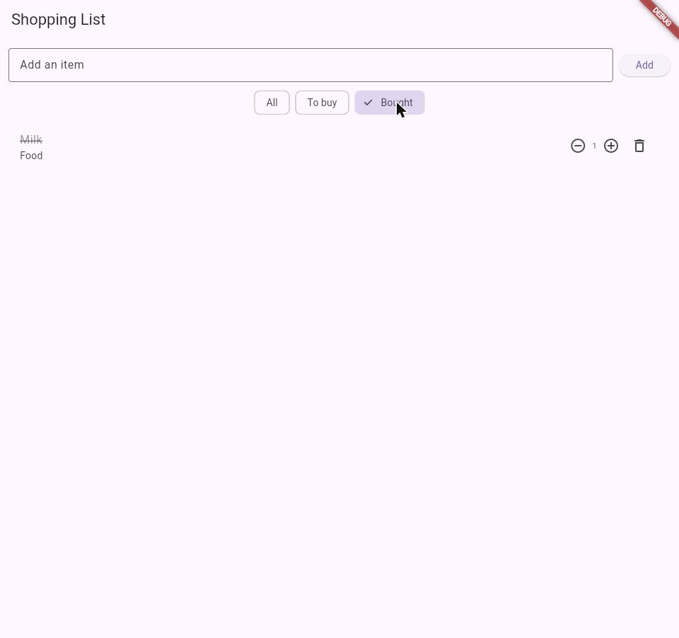
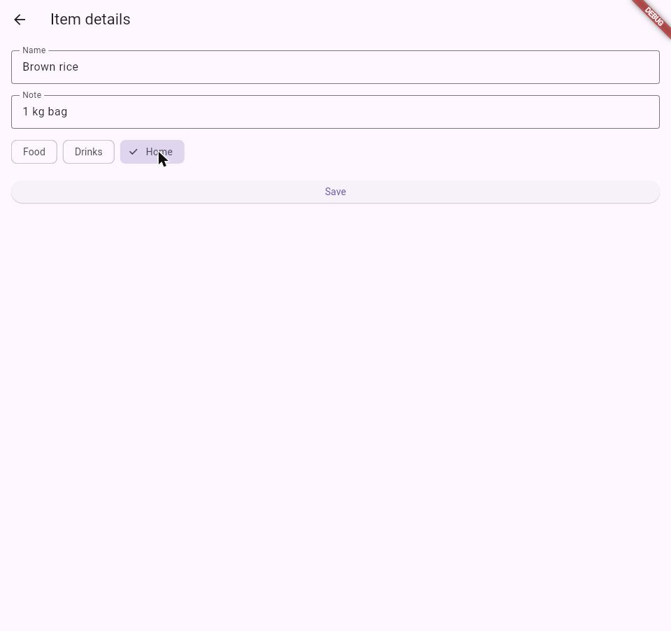

# Shopping List+

A Flutter shopping list app. Starts from the basic 8-step Shopping List
(add, display, mark as bought, delete) and adds six upgrades that make it
feel like a real app.

## Features

1. **Nothing to show** — an empty list shows "Your list is empty" centered
   on the page instead of a blank screen; it disappears again as soon as an
   item is added.
2. **How many?** — every item has a quantity starting at 1, shown between
   `−` and `+` buttons before the bin. `−` never drops below 1; the bin is
   still how you remove an item entirely.
3. **No duplicates, just more** — adding a name that's already on the list
   (ignoring case and surrounding spaces) bumps that item's quantity
   instead of inserting a second row, and shows a message like
   "Milk is already on the list: now ×2".
4. **Oops: undo** — deleting an item shows a SnackBar ("Bread removed")
   with an **Undo** button that puts the item back at its original
   position, with its quantity and bought status intact.
5. **Show me what's left** — three chips (All / To buy / Bought) filter the
   list. All keeps bought items at the bottom; To buy and Bought show just
   their subset. "Nothing here" covers an empty filter result, separately
   from the "Your list is empty" message for a truly empty list.
6. **Item details** — long-pressing a row opens a details screen with the
   item's name, a note, and a category (Food / Drinks / Home). Save
   validates the name isn't empty; the back arrow discards any changes.
   Each row shows its category and note underneath the name.

## Running it

```
flutter run
```

## Screenshots

| Quantity | Undo |
|---|---|
|  |  |

| Bought filter | Item details |
|---|---|
|  |  |

## Think

**1. In part 5, why does deleting by index remove the wrong item when a
filter is on? How did you fix it?**

Once a filter is active, the list on screen is a *subset* of `_items`, in
possibly a different order (All moves bought items to the bottom). If the
delete button used the row's position in that displayed list as the index
into `_items`, it would remove whatever happens to sit at that position in
the *full* list — almost always a different item than the one the user
tapped, since the two lists don't line up once something is filtered out
or reordered. I fixed it with a `_visibleIndices` getter that computes,
for the current filter, which *real* indices into `_items` should be
shown and in what order. Every row is built with `_buildRow(visible[i])`,
so its delete/toggle/quantity callbacks always close over the item's real
index in `_items`, never its position on screen. That's also why this bug
is silent and dangerous: nothing crashes, it just quietly acts on the
wrong row.

**2. Why did you have to remove `final` from `name`? Why is `final` still
a good choice for most fields?**

`final` means a field is set once (at construction) and can never be
reassigned. Before the details screen, `name` was only ever set when an
`Item` was created and otherwise just read — a perfect case for `final`.
Part 6 added renaming from the details screen (`widget.item.name = name`),
which *is* a reassignment, and Dart's compiler rejects that on a `final`
field. So `name` had to become a plain mutable field. `final` is still the
right default for everything that genuinely shouldn't change after
construction (like `bought`'s original intent, or the `TextEditingController`
references): it documents intent, and the compiler catches accidental
reassignment as a mistake instead of letting it silently compile.

**3. Why did you need a hot restart after adding quantity to `Item`, when
a save was enough for everything else?**

Hot reload patches the *code* of already-running classes without
destroying existing object instances — it can apply a changed method body
to objects that already exist. But adding a new field changes a class's
shape: the `Item` objects already sitting in `_items` were constructed
before `quantity` existed, so there's no memory allocated for it on those
instances, and hot reload can't retroactively insert a field into an
object that already exists. A hot *restart* reruns `main()` from scratch,
so every `Item` gets constructed fresh from the current `Item` class,
`quantity` included. Changing a method body (like `_addItem`) doesn't have
this problem — the instances don't need to change shape, so hot reload
can swap the method and keep going.

**4. The details screen changed the item, but the list only showed it
after `setState` in `.then`. Why? What does this tell you about how
Flutter decides when to redraw?**

Flutter only rebuilds a widget when something explicitly tells its
`State` to — almost always a call to `setState()`. Mutating a plain Dart
object's field directly, like `widget.item.name = name` on the details
screen, is invisible to the framework: `Item` isn't a `ChangeNotifier` and
nothing is "watching" it. The object really does change in memory, but
`_ShoppingListPageState` has no way of knowing that unless something
tells it to rebuild. `Navigator.push(...).then((_) { setState(() {}); })`
runs exactly when the details screen is popped and control returns to the
list, and calling `setState(() {})` — even with nothing in the callback —
is simply "rebuild me now", which re-runs `build()` and re-reads the
item's now-changed fields. The lesson: Flutter's UI is a pure function of
state *at the moment `build()` runs*; the framework doesn't watch your
data for you, you have to tell it when to look again.
